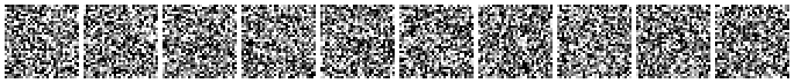
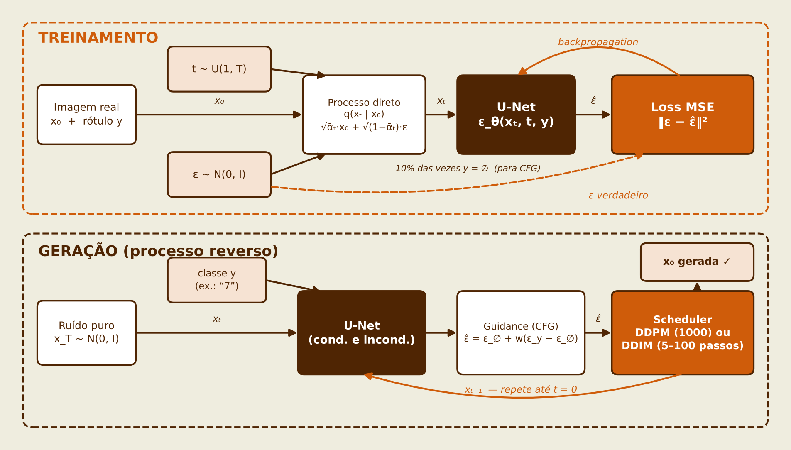
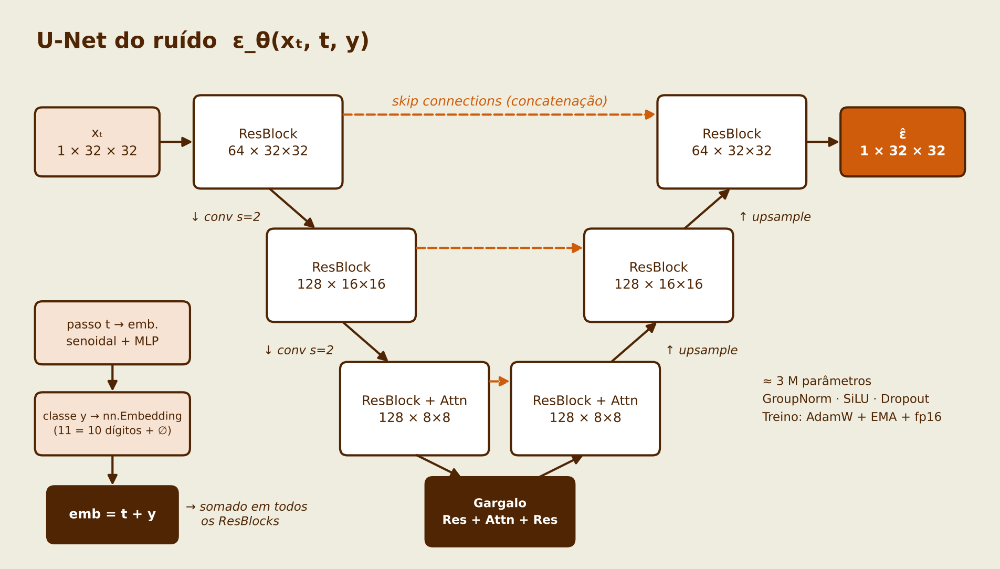
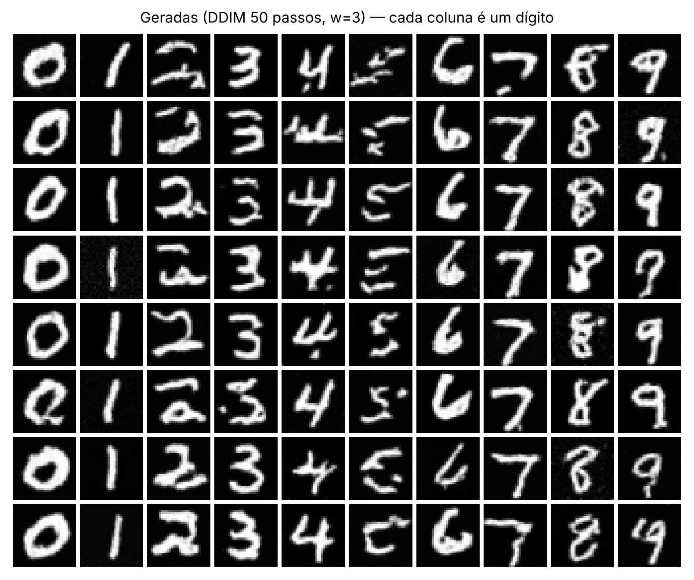
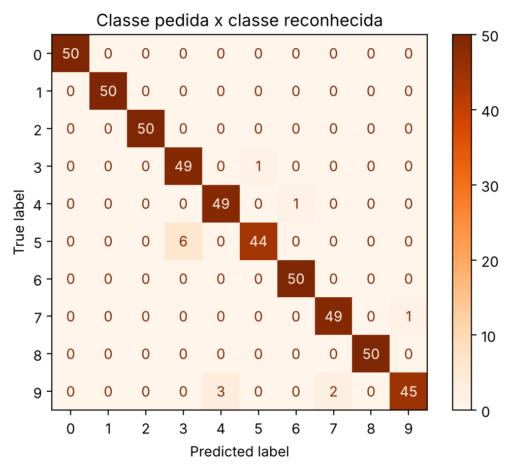
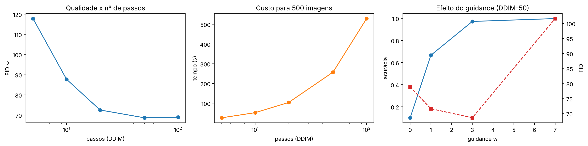

# Diffusion Models: do ruído à imagem

<a target="_blank" href="https://cookiecutter-data-science.drivendata.org/">
    
</a>

[](https://colab.research.google.com/github/biaag10/machine_learning_projects/blob/develop/diffusion_models/notebooks/Diffusion_Models_MNIST_SD.ipynb)

Projeto em grupo da disciplina de **IA Generativa** (SENAI CIMATEC).
**Grupo:** Bianca Andrade, Rafael Athaliba e Pedro Lima.

Implementamos **do zero**, em PyTorch, um modelo de difusão (**DDPM**) condicionado à classe, treinado no
MNIST para gerar o dígito pedido. Também mostramos a mesma técnica em escala real com o **Stable Diffusion
(SD-Turbo)**, gerando imagens a partir de texto.

<p align="center">
  
</p>

## Os 5 itens do trabalho

| Item | Onde está |
|---|---|
| 1. Fundamentação | Slides 3–10 · notebook, Seção 3 (processo direto) |
| 2. Arquitetura | Slides 11–14 · notebook, Seção 4 · `module_diffusion_models/modeling/unet.py` · `reports/figures/diagrama_*.png` |
| 3. Implementação funcional | Slides 15–17 · notebook, Seções 1–7 · `module_diffusion_models/` (DDPM treinado do zero) · `tests/` |
| 4. Avaliação experimental | Slides 18–25 · notebook, Seções 6 e 8–10 (loss, acurácia condicional, FID, tempo, erros, diversidade) |
| 5. Demonstração | Slides 26–27 · notebook, Seção 11 (app Gradio do nosso modelo) e Seção 12 (Stable Diffusion) |

## Como funciona

<p align="center">
  
</p>

- **Processo direto:** soma ruído gaussiano à imagem em T = 1000 passos (β linear de 1e-4 a 0,02), até sobrar só ruído. É um cálculo fixo, sem aprendizado.
- **Treinamento:** a U-Net recebe a imagem com ruído, o passo *t* e a classe, e **prevê o ruído** que foi adicionado. O erro é o MSE entre o ruído real e o previsto: é aprendizado supervisionado.
- **Geração:** parte de ruído puro e remove o ruído passo a passo. **DDPM** usa os 1000 passos; **DDIM** usa o mesmo modelo pulando passos (ex.: 50).
- **Classifier-Free Guidance (w):** em 10% do treino a classe é escondida; na geração, a previsão com classe e sem classe são combinadas para controlar o quanto a imagem obedece ao dígito pedido.

<p align="center">
  
</p>

## Experimento

| Item | Configuração |
|---|---|
| Dados | MNIST: 60 mil dígitos de treino, redimensionados para 32×32 e escala [-1, 1] |
| Modelo | U-Net condicional com embedding de tempo e de classe, atenção em 8×8, **~0,75 M parâmetros** (`CH = 32`) |
| Treino | 10 épocas, AdamW (lr 2e-4), batch 128, EMA 0,999, **~95 min em CPU** |
| Amostragem | DDPM (1000 passos) e DDIM (5 a 100 passos), guidance w = 0, 1, 3 e 7 |
| Avaliação | 500 imagens por configuração; classificador CNN auxiliar (95,6% no MNIST real) e FID |
| Escala real | SD-Turbo (Stable Diffusion destilado), texto → imagem 512×512 em 1–4 passos |

## Resultados

Tabela completa em [`reports/metricas.csv`](reports/metricas.csv). Tempos medidos em CPU, para 500 imagens.

| Amostrador | Passos | Guidance w | Acurácia condicional | FID ↓ | Tempo |
|---|---:|---:|---:|---:|---:|
| DDPM | 1000 | 3 | 97,6% | **50,4** | 81 min |
| DDIM | 100 | 3 | 97,6% | 68,9 | 8,8 min |
| **DDIM** | **50** | **3** | **97,2%** | **68,6** | **4,3 min** |
| DDIM | 20 | 3 | 97,4% | 72,5 | 1,7 min |
| DDIM | 10 | 3 | 97,2% | 87,7 | 52 s |
| DDIM | 5 | 3 | 97,8% | 117,9 | 26 s |
| DDIM | 50 | 0 (sem classe) | 10,0% | 78,9 | 4,2 min |
| DDIM | 50 | 1 | 66,6% | 71,7 | 4,3 min |
| DDIM | 50 | 7 | 99,8% | 101,6 | 4,3 min |

- **DDIM com 50 passos** gera **~19× mais rápido** que o DDPM com 1000, com 97,2% das amostras reconhecidas como a classe pedida.
- A qualidade (FID) melhora até ~50 passos e depois estabiliza; com 5 passos a imagem piora bastante.
- **w = 3** é o melhor equilíbrio: w = 0 ignora a classe (10%, o acaso) e w = 7 obedece quase sempre, mas as imagens ficam exageradas e o FID piora.
- Erros mais comuns (DDIM-50, w = 3): **5 gerado como 3** (6 casos) e **9 gerado como 4 ou 7** (5 casos), dígitos de formas parecidas.

<p align="center">
  
  
</p>
<p align="center">
  
</p>

## Como rodar

### No Google Colab (demonstração)

1. Clique no botão **Open in Colab** no topo desta página.
2. `Ambiente de execução → Alterar o tipo de ambiente de execução → GPU (T4)`.
3. `Ambiente de execução → Executar tudo`.

Por padrão (`TREINAR_DO_ZERO = False`), o notebook **carrega o modelo já treinado** (`models/ddpm_mnist_ema.pt`,
o mesmo dos slides), então não precisa treinar de novo. Para refazer o treino, marque `TREINAR_DO_ZERO = True`
na Seção 1 (~10 min na T4). O notebook é autocontido para rodar no Colab sem instalar o projeto.

### Localmente (uv)

Pré-requisito: [uv](https://docs.astral.sh/uv/) instalado.

```bash
uv sync                                   # cria o ambiente e instala as dependências (inclui PyTorch)
uv run pytest tests                       # roda os testes
uv run python -m module_diffusion_models.modeling.predict --digito 7   # gera dígitos com o modelo pronto
```

Para abrir o notebook localmente, selecione o kernel do ambiente do projeto (`.venv`). Sem GPU, ele roda com o
modelo pronto, avalia 100 imagens por configuração, pula o DDPM-1000 na avaliação e a Seção 12 (o SD-Turbo
exige GPU).

> **Windows com acento no caminho** (ex.: `Área de Trabalho`): crie o ambiente em uma pasta sem acento,
> como nos outros projetos: `$env:UV_PROJECT_ENVIRONMENT = "D:\venvs\diffusion_models"` antes do `uv sync`.

### Comandos do Makefile

| Comando | O que faz |
|---|---|
| `make requirements` | Instala as dependências com uv |
| `make data` | Baixa o MNIST em `data/raw/` |
| `make train` | Treina o DDPM do zero e salva `models/ddpm_mnist_ema.pt` e a curva de loss |
| `make predict` | Gera uma grade com os dígitos de 0 a 9 em `reports/figures/` |
| `make test` | Roda os testes |
| `make lint` / `make format` | Verifica / formata o código com ruff |

### Demonstração ao vivo

- **Demo 1, nosso modelo:** Seção 11 do notebook → abre um link `gradio.live` para escolher dígito, amostrador, passos, guidance e semente.
- **Demo 2, Stable Diffusion:** Seção 12 (GPU). O download do SD-Turbo tem ~2,5 GB: rode a 12a **antes** de começar a apresentação.
- **Plano B:** o GIF `reports/figures/09_processo_reverso.gif` mostra o processo reverso sem precisar rodar nada.

## Testes

`tests/test_diffusion.py` (10 testes) verifica:

- a estrutura de pastas do projeto;
- o agendamento de ruído (ᾱ_t começa perto de 1, só diminui e quase some em t = 999) e a fórmula do processo direto;
- que a U-Net devolve um ruído do mesmo tamanho da imagem e que o modelo do experimento tem ~750 mil parâmetros;
- que um passo de treino atualiza os pesos com uma loss válida;
- o Classifier-Free Guidance (w = 1 é a previsão condicional; w = 0, a incondicional);
- que o DDIM é determinístico (mesma semente, mesma imagem) e gera imagens em [-1, 1];
- que o modelo treinado de `models/` carrega e gera os dígitos.

## Estrutura de pastas

```
diffusion_models/
├── LICENSE
├── Makefile                      <- make requirements, data, train, predict, test
├── README.md
├── pyproject.toml                <- Dependências do projeto (uv)
├── uv.lock
├── data/                         <- NÃO versionado (o MNIST é baixado em data/raw)
│   ├── external
│   ├── interim
│   ├── processed
│   └── raw
├── docs/                         <- Documentação mkdocs
├── models/
│   └── ddpm_mnist_ema.pt         <- Pesos do modelo treinado (EMA, CH = 32)
├── notebooks/
│   └── Diffusion_Models_MNIST_SD.ipynb <- Notebook para rodar (Colab ou local)
├── references/
├── reports/
│   ├── metricas.csv              <- Acurácia, confiança, FID e tempo por configuração
│   ├── figures/                  <- Figuras do notebook, GIF e diagramas usados nos slides
│   └── apresentacao/             <- Slides da apresentação (PDF)
├── tests/
│   └── test_diffusion.py
└── module_diffusion_models
    ├── __init__.py
    ├── config.py                 <- Caminhos e hiperparâmetros do experimento
    ├── dataset.py                <- Download e carregamento do MNIST (32x32, [-1, 1])
    ├── diffusion.py              <- Agendamento de ruído e processo direto q(x_t | x_0)
    ├── plots.py                  <- Grades de imagens e curva de loss
    └── modeling
        ├── __init__.py
        ├── unet.py               <- U-Net com embedding de tempo e de classe
        ├── train.py              <- Loop de treino (MSE do ruído, CFG, EMA)
        └── predict.py            <- Geração: DDPM, DDIM e Classifier-Free Guidance
```

As figuras `v_*.png` são as imagens do slide 7 (imagem real, ruído, imagem com ruído e ruído previsto).

## Limitações

- O MNIST é simples (32×32, tons de cinza, fundo uniforme): bons resultados aqui não garantem o mesmo em fotos.
- Modelo pequeno (~0,75 M parâmetros) e treino curto (10 épocas).
- O FID com 500 amostras serve para **comparar as configurações entre si**, não com artigos (que usam 50 mil); a Inception foi treinada em fotos, não em dígitos.
- A acurácia condicional depende de um classificador que também erra (95,6% no MNIST real).
- O SD-Turbo foi usado pré-treinado, sem treinamento próprio.

## Referências

- Sohl-Dickstein, J. et al. *Deep Unsupervised Learning using Nonequilibrium Thermodynamics*. ICML, 2015.
- Ho, J.; Jain, A.; Abbeel, P. *Denoising Diffusion Probabilistic Models*. NeurIPS, 2020.
- Song, J.; Meng, C.; Ermon, S. *Denoising Diffusion Implicit Models*. ICLR, 2021.
- Ho, J.; Salimans, T. *Classifier-Free Diffusion Guidance*. 2022.
- Rombach, R. et al. *High-Resolution Image Synthesis with Latent Diffusion Models*. CVPR, 2022.
- Ronneberger, O.; Fischer, P.; Brox, T. *U-Net: Convolutional Networks for Biomedical Image Segmentation*. MICCAI, 2015.
- Sauer, A. et al. *Adversarial Diffusion Distillation*. 2023.
- Heusel, M. et al. *GANs Trained by a Two Time-Scale Update Rule Converge to a Local Nash Equilibrium* (FID). NeurIPS, 2017.
